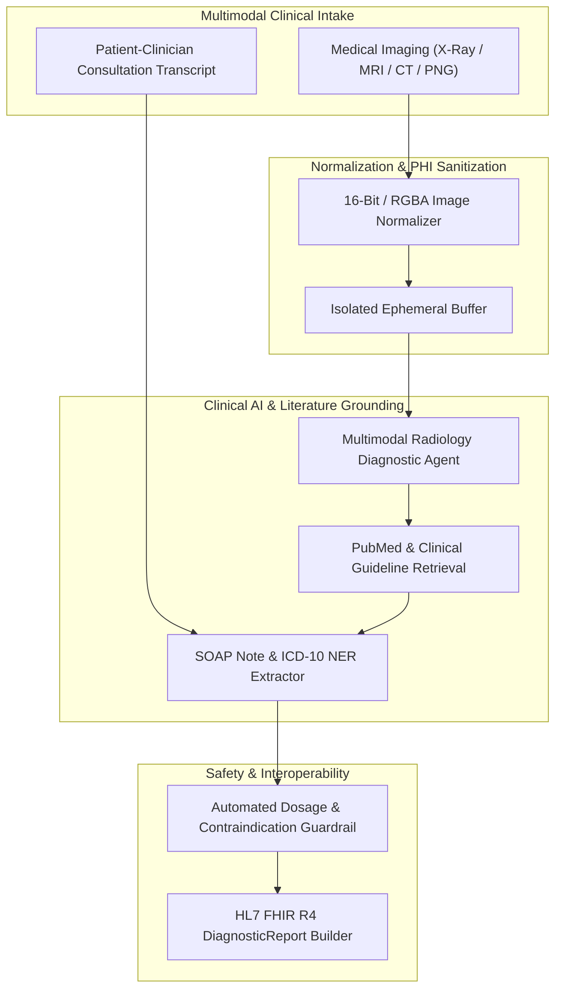
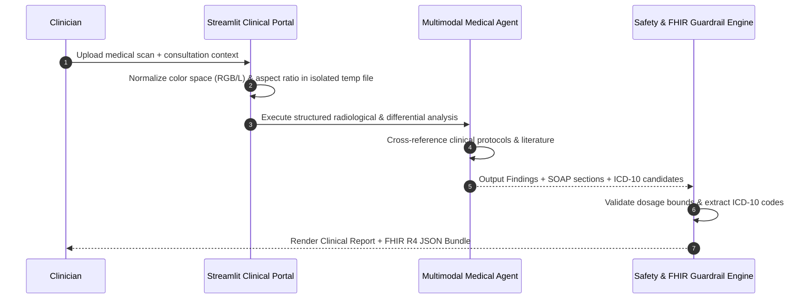

# Clinical AI Scribe, Multimodal Medical Imaging & Healthcare RAG Assistant

[](#)
[](#)
[](#)
[](#)

End-to-end **Healthcare AI Diagnostic & Ambient Clinical Scribe Platform** combining multimodal radiological image analysis (X-Ray, MRI, CT, Ultrasound) with structured **SOAP Note synthesis**, **ICD-10 medical coding extraction**, **HL7 FHIR R4 DiagnosticReport export**, and automated **clinical safety guardrails**.

---

## System Architecture



---

## Clinical Triage & Scribe Workflow



---

## Key Bug Fixes & Production Hardening

1. **Concurrent Tempfile Isolation (`app.py`):** Replaced the hardcoded shared `"temp_resized_image.png"` buffer (which caused multi-user race conditions and leaked patient scan files on disk) with isolated `tempfile.NamedTemporaryFile` descriptors cleaned up inside a strict `finally:` block.
2. **16-Bit Grayscale & RGBA Medical Scan Normalization:** Added automatic color-space normalization (`image.convert("RGB")`) and zero-dimension guards prior to aspect-ratio resizing, preventing `OSError: cannot write mode RGBA/I;16` crashes on hospital PNG/DICOM exports.
3. **Null-Safe Agent Output & Initialization Guard:** Added explicit checks for uninitialized agent state and empty/filtered `RunOutput.content` responses.
4. **HL7 FHIR R4 & Safety Guardrails (`clinical_scribe.py`):** Implemented deterministic ICD-10 regex NER extraction, unsafe dosage regex guardrails, and HL7 FHIR R4 `DiagnosticReport` serialization.

---

## Quickstart

```bash
git clone https://github.com/shubh9119/clinical-ai-medical-rag-assistant.git
cd clinical-ai-medical-rag-assistant
pip install -r requirements.txt
streamlit run app.py
```

### Run Unit Tests
```bash
pytest -v
```
